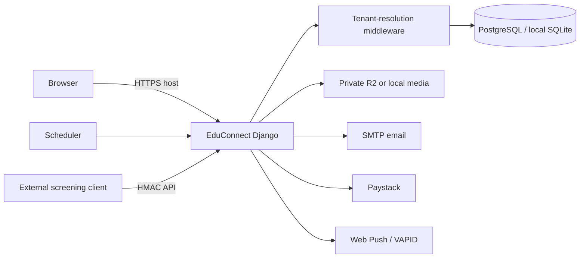

# EduConnect Documentation

EduConnect is a multi-tenant Django university-management portal. This document describes the repository as inspected; it does not describe unimplemented intended behaviour. Configuration examples are placeholders only.

## Table of Contents

1. [Overview](#1-overview)
2. [Architecture](#2-architecture)
3. [Installation and Local Development](#3-installation-and-local-development)
4. [Configuration Reference](#4-configuration-reference)
5. [User Roles and Access Control](#5-user-roles-and-access-control)
6. [Account and Password Lifecycle](#6-account-and-password-lifecycle)
7. [Feature Documentation](#7-feature-documentation)
8. [Security and Privacy](#8-security-and-privacy)
9. [Testing and QA](#9-testing-and-qa)
10. [Deployment and Operations](#10-deployment-and-operations)
11. [API and Integration Reference](#11-api-and-integration-reference)
12. [Support and Maintenance](#12-support-and-maintenance)
13. [Change Log](#13-change-log)
14. [Glossary](#glossary)
15. [Useful Commands Cheat Sheet](#useful-commands-cheat-sheet)
16. [Links](#links)
17. [Gaps and Open Questions](#gaps-and-open-questions)

## 1. Overview

EduConnect manages institution, academic, course, payment, communication, results, examination-card, accommodation, and applicant-screening data in one Django application. It supports university, polytechnic, college, and other institution types, as defined by [`Institution`](../portal/models.py). The web stack is Django 6.0.1, Python 3.12 container images, Gunicorn, WhiteNoise, PostgreSQL (or local SQLite/MySQL), and optional Cloudflare R2, Paystack, SMTP, Web Push, and OpenAI-backed document extraction ([`requirements.txt`](../requirements.txt), [`Dockerfile`](../Dockerfile)).

Roles persisted in code are Institution Admin (`admin`), Student, Lecturer, MIS, Bursary, Admission Officer, Academic Planning, HOD, Exam Officer, Senate Member, and Parent/Guardian; platform super administrators are Django superusers rather than a tenant role ([`User.Role`](../portal/models.py)). `RoleAssignment` adds auditable roles without replacing the legacy primary role.

## 2. Architecture



The real project entrypoints are [`manage.py`](../manage.py), [`config/settings.py`](../config/settings.py), [`config/urls.py`](../config/urls.py), [`portal/urls.py`](../portal/urls.py), [`portal/views.py`](../portal/views.py), [`portal/models.py`](../portal/models.py), and [`portal/services.py`](../portal/services.py). HTML is in [`templates/`](../templates); migrations are in [`portal/migrations/`](../portal/migrations); tests are listed in [Testing and QA](#9-testing-and-qa).

### Multi-tenant routing and isolation

`TenantResolutionMiddleware` maps a one-label subdomain of `CORE_DOMAIN` to `Institution.subdomain`, or maps an exact custom domain to `Institution.custom_domain` ([`portal/middleware.py`](../portal/middleware.py), [`config/domain.py`](../config/domain.py)). An unknown subdomain returns a custom 404. An authenticated tenant user on the central host is associated with their own institution for compatibility; an unrecognised tenant host is not inferred from the session. Custom domains must still pass Django host validation.

`TimeStampedModel`, `TenantManager`, and `TenantUserManager` attach/filter tenant-owned records using a request `ContextVar`; `TenantAccessMiddleware` also rejects a signed-in user whose institution does not match the resolved host ([`portal/models.py`](../portal/models.py), [`portal/middleware.py`](../portal/middleware.py)). File paths include tenant context for institutional logos and many document types; media is served through protected download views rather than public R2 URLs ([`portal/models.py`](../portal/models.py), [`config/storage.py`](../config/storage.py)). Background reminders use explicit institution filters ([`portal/services.py`](../portal/services.py)).

This is defense in depth, not a substitute for review: code that uses `all_objects`, `Institution.objects`, or an unscoped manager must apply explicit tenant filters. Examples needing continuing review include global super-admin dashboards and some automation duplicate checks using globally unique usernames ([`portal/views.py`](../portal/views.py), [`portal/automation.py`](../portal/automation.py)).

## 3. Installation and Local Development

Prerequisites: Python compatible with the pinned dependencies, pip, and optionally Docker Desktop. Follow the actual quick-start in [`README.md`](../README.md).

```powershell
pip install -r requirements.txt
copy .env.example .env
python manage.py migrate
python manage.py runserver
```

Use only placeholder values in local `.env`; it is deliberately ignored. [`settings.py`](../config/settings.py) loads it, while [`.env.example`](../.env.example) contains safe development defaults. Local SQLite is selected by `DJANGO_USE_LOCAL_SQLITE=True`.

Docker development uses [`compose.yaml`](../compose.yaml):

```powershell
docker compose up --build
```

It bind-mounts the repository, uses the local SQLite setting, applies migrations, then starts Django. Production Docker uses [`compose.production.yaml`](../compose.production.yaml), PostgreSQL, Gunicorn, Caddy, and separate reminder services; it expects a production environment file. Staging is not separately defined in source: use production-equivalent configuration with separate domains, database, R2 bucket, SMTP, Paystack keys, VAPID keys, and scheduler secret. **Needs confirmation:** no dedicated staging settings module or deployment manifest exists.

## 4. Configuration Reference

All names below come from [`.env.example`](../.env.example), [`config/settings.py`](../config/settings.py), or [`config/storage.py`](../config/storage.py). Do not store real secrets in source control.

| Variable | Purpose / required state | Development example | Production owner/source |
|---|---|---|---|
| `DJANGO_DEBUG`, `DJANGO_SECRET_KEY`, `DJANGO_TIME_ZONE` | Core settings; a non-default secret is required in production | `True`, placeholder secret, `Africa/Lagos` | deployment secret/config ([`settings.py`](../config/settings.py)) |
| `DJANGO_USE_LOCAL_SQLITE`, `DATABASE_URL` | Local SQLite switch or managed DB URL | `True`; unset URL | platform/DB administrator ([`settings.py`](../config/settings.py)) |
| `DB_ENGINE`, `DB_NAME`, `DB_USER`, `DB_PASSWORD`, `DB_HOST`, `DB_PORT`, `DB_CONN_MAX_AGE`, `DB_SSLMODE` | Optional direct PostgreSQL/MySQL configuration | leave unset for SQLite | DB administrator ([`settings.py`](../config/settings.py)) |
| `CORE_DOMAIN`, `DJANGO_ALLOWED_HOSTS`, `CSRF_TRUSTED_ORIGINS`, `RENDER_EXTERNAL_HOSTNAME` | Host, tenant subdomains, CSRF, Render host | blank core domain and localhost hosts | DevOps ([`settings.py`](../config/settings.py)) |
| `SESSION_COOKIE_AGE`, `EDUCONNECT_MAX_UPLOAD_BYTES` | Session lifetime and upload ceiling | defaults: 8 hours and 10 MiB | DevOps ([`settings.py`](../config/settings.py)) |
| `EMAIL_BACKEND`, `EMAIL_HOST`, `EMAIL_PORT`, `EMAIL_HOST_USER`, `EMAIL_HOST_PASSWORD`, `EMAIL_USE_TLS`, `EMAIL_USE_SSL`, `EMAIL_TIMEOUT`, `DEFAULT_FROM_EMAIL` | Email transport | console backend | email owner/secret manager ([`.env.example`](../.env.example)) |
| `AWS_ACCESS_KEY_ID`, `AWS_SECRET_ACCESS_KEY`, `AWS_STORAGE_BUCKET_NAME`, `AWS_S3_ENDPOINT_URL`, `AWS_S3_REGION_NAME`, `AWS_DEFAULT_ACL`, `AWS_QUERYSTRING_AUTH`, `DJANGO_MEDIA_ROOT` | R2/private media or local media directory | leave R2 unset | storage owner; all required R2 values required when `DEBUG=False` ([`config/storage.py`](../config/storage.py)) |
| `PAYSTACK_SECRET_KEY`, `PAYSTACK_PUBLIC_KEY`, `PAYSTACK_CREDENTIALS_ENCRYPTION_KEY`, `PAYSTACK_CREDENTIALS_PREVIOUS_ENCRYPTION_KEYS` | Platform Paystack and encrypted tenant credentials | unset | payments owner/secret manager ([`settings.py`](../config/settings.py), [`portal/fields.py`](../portal/fields.py)) |
| `VAPID_PUBLIC_KEY`, `VAPID_PRIVATE_KEY`, `VAPID_CLAIMS_EMAIL` | Optional browser push | unset | notifications owner ([`.env.example`](../.env.example)) |
| `EDUCONNECT_CRON_SECRET` | Protects the HTTP reminder trigger | unique local placeholder | scheduler/secret manager ([`settings.py`](../config/settings.py)) |
| `OPENAI_API_KEY`, `OPENAI_AUTOMATION_MODEL`, `OPENAI_LOGO_LOOKUP_MODEL`, `OPENAI_LOGO_PROCESSING_MODEL` | Optional document/logo automation | unset/keyless fallback | AI owner ([`settings.py`](../config/settings.py), [`portal/automation.py`](../portal/automation.py)) |
| `BOOTSTRAP_ADMIN_USERNAME`, `BOOTSTRAP_ADMIN_PASSWORD`, `BOOTSTRAP_ADMIN_EMAIL` | Optional first platform super-admin | blank | platform owner ([`.env.example`](../.env.example)) |
| `SCREENING_APPLICATION_URL_TEMPLATE`, `SCREENING_API_MAX_CLOCK_SKEW_SECONDS`, `TRUSTED_PROXY_IPS`, `SECURE_HSTS_SECONDS`, `DJANGO_TEST_FAST_PASSWORD_HASHER` | Screening URL/signing window, trusted proxies, HSTS override, test-only hashing | defaults/unset | DevOps/security ([`settings.py`](../config/settings.py)) |

Per-department/course and platform subscription Paystack credentials are stored in encrypted model fields, configured through the application, not through per-institution environment variables ([`portal/models.py`](../portal/models.py), [`portal/fields.py`](../portal/fields.py)).

## 5. User Roles and Access Control

| Role | Implemented purpose and boundary |
|---|---|
| Platform Super Admin | Django superuser with no tenant. Manages institutions, plans, subscriptions, global policies, screening configuration, audit/report views and platform settings ([`portal/views.py`](../portal/views.py)). |
| Institution Admin | Tenant administrator: departments, faculties, programmes, users/lecturer approval, courses, materials, documents, HODs, billing and accommodation administration. Tenant subscription status can restrict access ([`portal/views.py`](../portal/views.py)). |
| Lecturer | Requires approval before dashboard access. Manages assigned courses, materials, groups, student lists, messages, and result drafts ([`portal/views.py`](../portal/views.py)). |
| HOD | Additive lecturer responsibility, limited to its department; manages departmental fees/API/documents, programmes, staff/course allocation and Exam Officer assignment ([`portal/views.py`](../portal/views.py)). |
| Exam Officer | Built. Reviews/publishes results and approves exam-card workflows for its department ([`portal/views.py`](../portal/views.py), [`portal/test_exam_officer_workflows.py`](../portal/test_exam_officer_workflows.py)). |
| Student | Self-registers, manages course registration/payment, materials, messages, documents, accommodation, and published results ([`portal/views.py`](../portal/views.py)). |
| Admission Officer | Role and AI response exist, and screening APIs exist; no dedicated Admission Officer HTML module/URL is present. **Partly built.** ([`portal/models.py`](../portal/models.py), [`portal/views.py`](../portal/views.py)). |
| MIS, Bursary, Academic Planning, Senate Member, Parent/Guardian | Roles and selected role/AI behavior exist. Dedicated operational modules are limited or absent. **Needs confirmation before onboarding these roles.** ([`portal/models.py`](../portal/models.py), [`portal/views.py`](../portal/views.py)). |

`role_required`, `super_admin_required`, `User.has_role`, active-role switching, department lookups, and tenant middleware enforce server-side access; templates are not the authority ([`portal/views.py`](../portal/views.py), [`portal/models.py`](../portal/models.py)).

### Audit logging

`AuditLog` stores `institution`, `user`, `action`, `description`, `object_type`, `object_id`, `old_value`, `new_value`, `ip_address`, and `created_at` ([`portal/models.py`](../portal/models.py)). Literal action names are `academic_session_created`, `academic_session_semester_changed`, `accommodation_application_created`, `account_activated`, `ai_assistant_query`, `ai_automation_analyzed`, `ai_automation_approved`, `ai_automation_executed`, `course_allocation_duplicate`, `course_allocation_reconciled`, `departmental_document_replaced`, `exam_card_ai_approved`, `exam_card_ai_configured`, `exam_card_ai_reference_uploaded`, `exam_officer_assigned`, `global_policy_draft_created`, `global_policy_draft_updated`, `global_policy_published`, `hod_assigned`, `hod_course_pricing_updated`, `institution_admin_password_changed`, `institution_admin_password_reset`, `institution_created`, `institution_deleted`, `institution_updated`, `login`, `logout`, `platform_administrator_created`, `profile_updated`, `programme_created`, `programme_deleted`, `programme_handbook_uploaded`, `programmes_imported`, `result_file_imported`, `screening_api_secret_rotated`, `screening_application_admitted`, `screening_application_received`, `screening_configuration_updated`, `screening_student_transferred`, `subscription_checkout_started`, `subscription_gateway_updated`, `subscription_payment_failed`, `subscription_plan_activated`, `subscription_plan_created`, `subscription_plan_deleted`, `subscription_plan_duration_created`, `subscription_plan_duration_updated`, `subscription_plan_updated`, and `subscription_renewed`. Dynamic names include `policy_{event}`, `institution_{status}`, `accommodation_{action}_created`, `accommodation_application_{action}`, `exam_card_{action}d`, and `result_{action}d`; their concrete value depends on the executed action ([`portal/views.py`](../portal/views.py), [`portal/services.py`](../portal/services.py)).

## 6. Account and Password Lifecycle

### Provisioning and temporary passwords

When a platform super-admin creates an institution, its administrator username is the institution email. The temporary password is `lowercase-subdomain + "educonnect"`; `mau` yields `maueduconnect`. No minimum-subdomain length is enforced by `provisioned_password_for`, so a one- or two-character valid subdomain produces the corresponding short prefix. The temporary password has no expiry in code and is not forcibly changed at first login ([`portal/services.py`](../portal/services.py), [`portal/views.py`](../portal/views.py)). Admins are prompted to use the profile/reset flow to change it promptly.

Institution-created lecturers use the same subdomain-derived password and their lecturer ID becomes their username in the manual form. They remain pending until approved. Departmental lecturer imports and reviewed automation follow their own provisioning code; inspect current import behavior before bulk use ([`portal/forms.py`](../portal/forms.py), [`portal/automation.py`](../portal/automation.py)). Students retain the existing registration flow, choosing a password subject to normal validation ([`portal/forms.py`](../portal/forms.py), [`portal/views.py`](../portal/views.py)).

Legacy accounts with the old `educonnect` temporary password can use the new derived password once; that replaces the legacy hash immediately ([`portal/services.py`](../portal/services.py)).

### Email verification, activation, reset, throttling, sessions

There are two implemented mechanisms:

- `AccountActivation` creates a token-hash-backed, one-time password-set link lasting 24 hours. It is used for activation/reset situations such as screening-created students and admin-initiated user password reset ([`portal/services.py`](../portal/services.py), [`portal/views.py`](../portal/views.py)).
- Password reset sends a six-digit email OTP, stores only an HMAC digest in the browser session, expires after 15 minutes, and allows five failed code attempts before reset is required. Unknown-email responses remain neutral ([`portal/views.py`](../portal/views.py)).

`EmailVerificationOTP` and `send_email_verification_otp` exist and issue a 15-minute code, but no URL route or view consumes the record or prevents administrator login based on `email_verified`. Therefore, **administrator sign-in OTP verification is not implemented end to end** ([`portal/models.py`](../portal/models.py), [`portal/services.py`](../portal/services.py), [`portal/urls.py`](../portal/urls.py)).

Passwords must be at least 12 characters, not common, not numeric-only, and not overly similar to user attributes ([`config/settings.py`](../config/settings.py)). Login throttling locks the tuple of client IP and case-folded username after five failures; it lasts 15 minutes and clears on success ([`portal/views.py`](../portal/views.py)). Session cookies are HTTP-only, Lax, browser-close expiry, with default age 8 hours ([`config/settings.py`](../config/settings.py)).

## 7. Feature Documentation

### Institution and subscription management

Super Admin creates/edits institutions, assigns an initial admin, and grants a 183-day six-month trial. Institution Admin starts subscription checkout and receives a receipt. Supported payment duration values are 183, 365, 730, and 1825 days (six months, one, two, and five years); the subscription plan editor determines active offerings ([`portal/services.py`](../portal/services.py), [`portal/models.py`](../portal/models.py), [`portal/views.py`](../portal/views.py)). Active/expiring subscriptions allow tenant access; inactive, expired, suspended, missing-subscription, or non-active institution states redirect protected tenant paths to billing, apart from defined billing/logout/home exceptions ([`portal/middleware.py`](../portal/middleware.py)). Related tests: [`portal/test_saas.py`](../portal/test_saas.py), [`portal/tests.py`](../portal/tests.py).

### Academic structure and student registration

Institution Admin manages faculties, departments and programmes. Students can self-register, select department/programme/level, receive a curriculum snapshot, and register courses in the current session. Profile department/programme or level changes can update curriculum/clear registrations; paid courses require renewed payment after relevant changes ([`portal/forms.py`](../portal/forms.py), [`portal/views.py`](../portal/views.py), [`portal/models.py`](../portal/models.py)). Related tests: [`portal/tests.py`](../portal/tests.py), [`portal/test_shared_courses.py`](../portal/test_shared_courses.py).

### Admission and applicant screening

The signed `/api/v1/` screening integration is built: it validates HMAC, timestamp/replay controls, tenant institution code, open integration configuration, application upsert/status/admission, and student transfer ([`portal/urls.py`](../portal/urls.py), [`portal/views.py`](../portal/views.py), [`portal/models.py`](../portal/models.py)). A public applicant-facing UI is not in this repository; `SCREENING_APPLICATION_URL_TEMPLATE` points to independently hosted software. Related tests: [`portal/test_saas.py`](../portal/test_saas.py).

### Payments

Institution subscription, course, and departmental payments initialize Paystack server-side and verify reference, amount (kobo), status, and currency before finalization. Payment callbacks are scoped to the active institution. The webhook verifies Paystack signatures and processes subscription payment reference idempotently ([`portal/services.py`](../portal/services.py), [`portal/views.py`](../portal/views.py)). HOD-configured departmental/course gateways and platform subscription gateway credentials are encrypted at rest ([`portal/models.py`](../portal/models.py), [`portal/fields.py`](../portal/fields.py)). Related tests: [`portal/tests.py`](../portal/tests.py).

### Lecturer workflows, materials, groups, and documents

Lecturers require approval, operate allocated courses, upload materials, gate material access, send targeted messages, view students, and create paid-course groups/PDFs. HODs can manage departmental lecturers, course allocation, departmental payment configuration, fee documents, programmes, and Exam Officer assignments ([`portal/views.py`](../portal/views.py), [`portal/automation.py`](../portal/automation.py)). Departmental documents are private downloads with role/object checks and diagnostics; students submit required departmental-payment documents ([`portal/views.py`](../portal/views.py), [`portal/departmental_document_diagnostics.py`](../portal/departmental_document_diagnostics.py)). Related tests: [`portal/tests.py`](../portal/tests.py), [`portal/test_policy_allocation_qr.py`](../portal/test_policy_allocation_qr.py).

### Results, exam cards, and accommodation

Lecturers draft/import results; Exam Officers/HODs review and publish. Departmental payments support exam-card approval, opaque verification tokens, QR-style verification PDF paths, and optional AI verification configuration ([`portal/models.py`](../portal/models.py), [`portal/views.py`](../portal/views.py)). Accommodation is built: sessions, hostels, blocks, rooms, beds, student applications, administrator decisions and allocations ([`portal/models.py`](../portal/models.py), [`portal/views.py`](../portal/views.py)). Related tests: [`portal/test_results.py`](../portal/test_results.py), [`portal/test_exam_officer_workflows.py`](../portal/test_exam_officer_workflows.py), [`portal/test_accommodation.py`](../portal/test_accommodation.py).

### Notifications, reminders, and EduConnect AI

Lecturer/HOD messages create in-app records, optional email, browser alerts, and Web Push. Reminder processing targets active lecturer allocations and student registrations for current sessions, 25–35 minutes before a scheduled course, with persistent claim/retry records ([`portal/services.py`](../portal/services.py), [`LECTURE_REMINDERS.md`](../LECTURE_REMINDERS.md)). Subscription expiry email runs at 60, 30, 7, 1 and 0 days, idempotently ([`portal/services.py`](../portal/services.py)).

The assistant is deterministic role-scoped query logic, not a general LLM chat interface. Optional OpenAI usage is for document extraction and logo processing. Institution Admin account automation validates a supported uploaded file, records the proposal and audit events, then immediately performs its valid account-creation rows ([`portal/views.py`](../portal/views.py), [`portal/automation.py`](../portal/automation.py)). Related tests: [`portal/tests.py`](../portal/tests.py), [`portal/test_security_remediation.py`](../portal/test_security_remediation.py).

## 8. Security and Privacy

Implemented controls include CSRF middleware, secure production cookies/redirect/HSTS, CSP and related headers, host validation, upload filename/type/size filtering, password validation, tenant access middleware, encrypted credential fields, private R2 configuration, signed screening requests, login throttling, audit records, one-time activation links, and OTP digests ([`config/settings.py`](../config/settings.py), [`portal/middleware.py`](../portal/middleware.py), [`portal/fields.py`](../portal/fields.py)).

Security issues to prioritize:

1. **High — shared predictable temporary passwords:** the subdomain-derived password does not expire and is not forcibly changed on first login. Treat it as an onboarding risk, even though a password reset can replace it ([`portal/services.py`](../portal/services.py)).
2. **High — OTP onboarding is incomplete:** the model/email sender exists but there is no consumer route/view or login gate. Do not claim email verification protects administrator sign-in ([`portal/models.py`](../portal/models.py), [`portal/services.py`](../portal/services.py), [`portal/urls.py`](../portal/urls.py)).
3. **Medium — scheduler overlap:** Render, Docker, and GitHub Actions configurations can all invoke reminder processing. Claims reduce duplicates but cannot guarantee exactly-once email after a provider-accept/database-write crash ([`render.yaml`](../render.yaml), [`compose.production.yaml`](../compose.production.yaml), [`LECTURE_REMINDERS.md`](../LECTURE_REMINDERS.md)).
4. **Medium — tenant scoping requires ongoing review:** tenant-aware managers do not protect explicit global managers; review automation and all `all_objects` uses whenever adding cross-tenant features ([`portal/models.py`](../portal/models.py), [`portal/automation.py`](../portal/automation.py)).

Known scope-sensitive code paths are: `analyze_institution_automation` tests duplicate usernames/emails globally but resolves departments through the tenant-aware manager; `execute_institution_automation` globally tests usernames before creating a user; and central platform views intentionally query all institutions/payments. The first two are safe only if global usernames/emails are a deliberate platform-wide identity policy; otherwise they can incorrectly suppress a valid tenant-local import. The latter are protected by `super_admin_required`, but must never be reused in tenant views ([`portal/automation.py`](../portal/automation.py), [`portal/views.py`](../portal/views.py)).

Retention, backups, and incident response are described at a policy level but not implemented as automated retention/backup/incident workflows. **Needs confirmation** ([`EDUCONNECT_FULL_PLATFORM_SECURITY_AUDIT.md`](../EDUCONNECT_FULL_PLATFORM_SECURITY_AUDIT.md)).

## 9. Testing and QA

Real test modules are [`portal/tests.py`](../portal/tests.py), [`portal/test_accommodation.py`](../portal/test_accommodation.py), [`portal/test_exam_officer_workflows.py`](../portal/test_exam_officer_workflows.py), [`portal/test_lecture_reminders.py`](../portal/test_lecture_reminders.py), [`portal/test_policies.py`](../portal/test_policies.py), [`portal/test_policy_allocation_qr.py`](../portal/test_policy_allocation_qr.py), [`portal/test_results.py`](../portal/test_results.py), [`portal/test_saas.py`](../portal/test_saas.py), [`portal/test_security_remediation.py`](../portal/test_security_remediation.py), and [`portal/test_shared_courses.py`](../portal/test_shared_courses.py).

Use the CI-equivalent commands from [`.github/workflows/ci.yml`](../.github/workflows/ci.yml):

```powershell
python manage.py makemigrations --check --dry-run
python manage.py check
python manage.py collectstatic --noinput
python manage.py test --verbosity 2
python manage.py check --deploy
```

For this documentation pass, `python manage.py check` passed using the repository virtual environment and safe placeholder settings. `python manage.py check --deploy` completed with the expected warning that the deliberately short check-only secret is weak. A complete test run was attempted but did not return within the 300-second tool timeout; it is **not reported as passing**. Do not use production data or credentials in tests.

Pre-release: review migrations, run the commands above in CI, test tenant-host isolation, payments with non-production keys, email/push paths, scheduler once only, private document authorization, and rollback restoration.

## 10. Deployment and Operations

Render is defined in [`render.yaml`](../render.yaml): it installs dependencies, collects static assets, runs schema diagnostics/migrations, starts Gunicorn, and defines daily subscription-expiry and per-minute course-reminder cron services. Docker production is defined in [`compose.production.yaml`](../compose.production.yaml): PostgreSQL, Gunicorn, Caddy, and looping command-runner services. The container entrypoint migrates and runs `collectstatic` before application start ([`docker-entrypoint.sh`](../docker-entrypoint.sh)). Caddy terminates TLS and reverse-proxies to the web container ([`Caddyfile`](../Caddyfile)).

Set `CORE_DOMAIN` to the bare production domain; configure wildcard DNS/TLS coverage for tenant subdomains and explicitly allow custom domains. R2 is required by settings when production debug is false. Monitor web/Gunicorn, scheduler, SMTP, Paystack, and database logs. Backup/restore and rollback runbooks are not fully implemented in code; take DB and storage backups before migration/deployment and use provider rollback controls. See [`DEPLOYMENT.md`](../DEPLOYMENT.md).

## 11. API and Integration Reference

Screening API paths are defined in [`portal/urls.py`](../portal/urls.py): `/api/v1/institutions/<institution_code>/`, `/api/v1/screening/applications/`, application status/admit paths, and `/api/v1/screening/students/`. Requests use institution, timestamp, and HMAC-SHA256 signature headers and a replay ledger; authentication is implemented in [`portal/views.py`](../portal/views.py). Error responses are JSON with appropriate 400/403/404/409 status paths.

The Paystack webhook is `POST /paystack/webhook/`. It validates an HMAC signature against configured platform/tenant keys and finalizes known subscription payments idempotently; course/department callbacks verify directly with their stored key ([`portal/urls.py`](../portal/urls.py), [`portal/views.py`](../portal/views.py), [`portal/services.py`](../portal/services.py)). The authenticated reminder endpoint is `POST /internal/cron/lecture-reminders/` using `X-EduConnect-Cron-Secret` ([`portal/urls.py`](../portal/urls.py), [`LECTURE_REMINDERS.md`](../LECTURE_REMINDERS.md)).

Paystack initialization sends email, kobo amount, reference, callback URL and optional metadata. Finalization locks the payment, validates Paystack `success` status, exact reference, exact amount, and currency, then leaves already-successful payments unchanged. Webhook signature candidates come from configured platform subscription credentials and tenant gateway credentials; a webhook does not trust a browser-supplied institution identifier ([`portal/services.py`](../portal/services.py), [`portal/views.py`](../portal/views.py)).

SMTP and browser push are internal integrations, not public APIs. Email failures are handled per operation; reminder deliveries persist success/failure/claim state. Web Push requires VAPID configuration and user browser subscriptions ([`portal/services.py`](../portal/services.py)).

## 12. Support and Maintenance

Common operational checks: validate `CORE_DOMAIN`/DNS for a tenant-host issue; tenant status/subscription for billing redirect; SMTP configuration for reset/reminder mail; department gateway configuration for payment errors; upload/storage availability for documents; active current session and course schedule for reminders. Use audit logs and non-sensitive server logs; never request passwords, OTPs, API keys, or student records in tickets.

Data repair must be tenant-scoped, auditable, backed up, and tested against a copy. Change management should require code review, migration review, deployment plan, rollback plan, and documentation review. Assign documentation ownership to the platform maintainer; review this document at each release and at least quarterly. Exact support SLAs and escalation contacts are **not implemented** ([`SAAS_ARCHITECTURE.md`](../SAAS_ARCHITECTURE.md)).

## 13. Change Log

| Date | Change summary | Author/owner | Affected modules | Migration required | Configuration changes | Security impact | Tests run | Rollback plan |
|---|---|---|---|---|---|---|---|---|
| YYYY-MM-DD |  |  |  | Yes/No |  |  |  |  |

## Glossary

- **Tenant:** an `Institution` and its isolated institutional records.
- **Central host:** the bare `CORE_DOMAIN` platform host.
- **Role assignment:** an additive, auditable role attached to a tenant user.
- **Activation link:** one-time password-set URL backed by `AccountActivation`.
- **OTP:** six-digit, time-limited email code used by password reset; onboarding enforcement is incomplete.
- **Current session:** tenant academic session marked current.

## Useful Commands Cheat Sheet

```powershell
python manage.py migrate
python manage.py runserver
python manage.py test --verbosity 2
python manage.py check
python manage.py check --deploy
python manage.py send_due_course_reminders
python manage.py send_subscription_expiry_notifications
docker compose up --build
docker compose -f compose.production.yaml up --build
```

Command implementations and deployment contexts: [`manage.py`](../manage.py), [`portal/management/commands/send_due_course_reminders.py`](../portal/management/commands/send_due_course_reminders.py), [`portal/management/commands/send_subscription_expiry_notifications.py`](../portal/management/commands/send_subscription_expiry_notifications.py), [`compose.yaml`](../compose.yaml), and [`compose.production.yaml`](../compose.production.yaml).

## Links

- [README](../README.md)
- [Deployment guide](../DEPLOYMENT.md)
- [SaaS architecture](../SAAS_ARCHITECTURE.md)
- [Security audit](../EDUCONNECT_FULL_PLATFORM_SECURITY_AUDIT.md)
- [Security remediation report](../EDUCONNECT_SECURITY_REMEDIATION_REPORT.md)
- [Reminder runbook](../LECTURE_REMINDERS.md)

## Gaps and Open Questions

1. **Not implemented:** end-to-end institution-admin email OTP verification. `EmailVerificationOTP` and an email sender exist, but no consuming URL/view/login gate exists.
2. **Needs confirmation:** the documented temporary-password policy is not forced at first login, has no expiry, and is predictable from a public subdomain. Decide whether to replace it with activation links or implement an enforced OTP/change flow.
3. **Needs confirmation:** no dedicated Admission Officer UI/module exists, despite the role, screening API and AI response.
4. **Needs confirmation:** MIS, Bursary, Academic Planning, Senate Member, and Parent/Guardian roles lack clearly dedicated end-user modules in this repository.
5. **Needs confirmation:** select exactly one reminder scheduler in production. Render, Docker, and GitHub Actions are all configured; the runbook warns against overlap.
6. **Not implemented in repository:** a dedicated staging configuration/deployment definition, automated backup/restore/retention workflows, incident-response workflow, support SLA, and data-repair runbook.
7. **Needs confirmation:** production configuration differs between older deployment documentation and the current R2-required production settings; validate the live storage plan before deployment.
8. **Validation limitation:** the full test suite did not complete within 300 seconds in this documentation environment; run it in CI before release.
